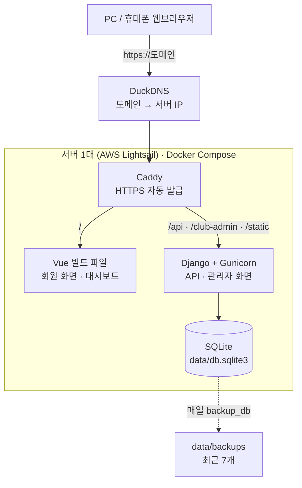
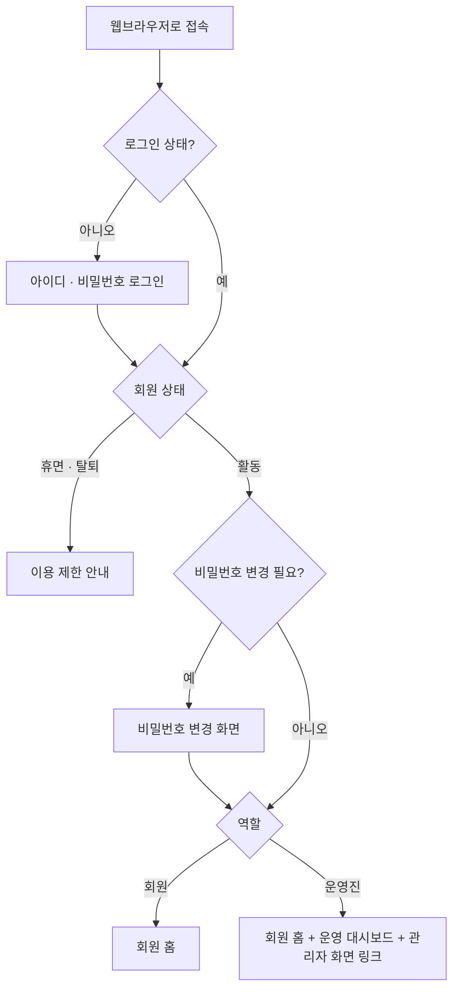
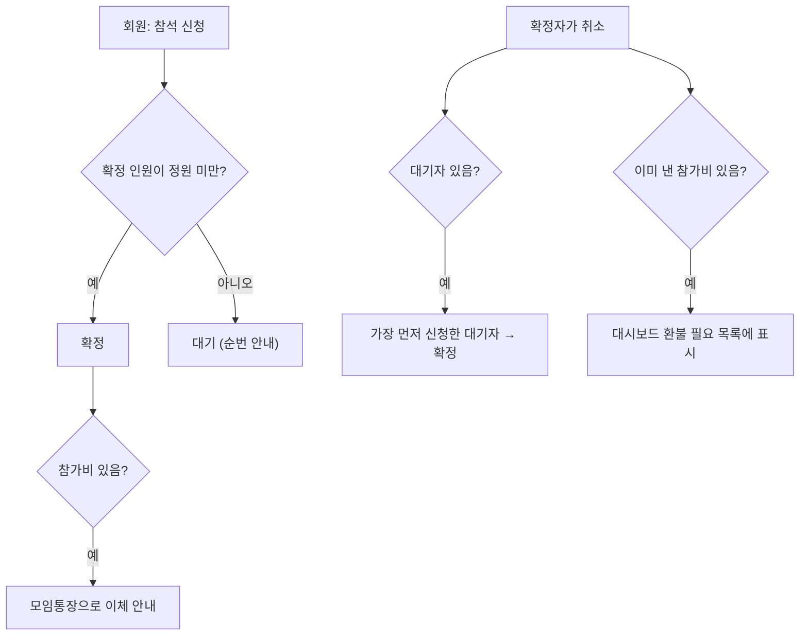
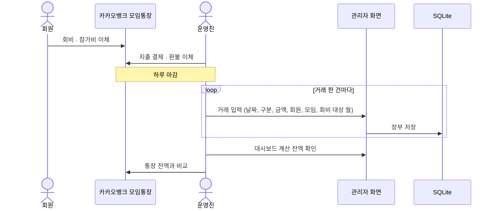

# Club Manager (AI_Club_Web)

30명 미만 소규모 동아리를 위한 **회원·모임·출석·회비 장부 관리 웹**입니다.

- 회원은 PC나 휴대폰 웹브라우저로 모임 일정을 보고, 참석을 신청하고, 자신의 출석과 회비 납부 내역, 공지를 확인합니다.
- 운영진은 관리자 화면에서 회원 계정, 모임, 출석, 장부(카카오뱅크 모임통장 거래내역)를 관리하고, 운영 대시보드에서 잔액과 미납자를 확인합니다.
- 서버 한 대(월 $5 수준)에서 Docker Compose로 실행됩니다.

| 주소 | 화면 |
| --- | --- |
| `/` | 회원 화면 (Vue) |
| `/dashboard` | 운영 대시보드 (운영진만) |
| `/club-admin/` | 관리자 화면 (Django Admin, 운영진만) |
| `/api/` | API |

---

## 주요 기능

| 기능 | 회원 | 운영진 |
| --- | --- | --- |
| 계정 | 로그인, 첫 로그인 시 비밀번호 변경, 내 정보 | 계정 발급, 비밀번호 초기화, 회원 상태(활동·휴면·탈퇴) 관리 |
| 모임 | 목록·상세, 참석 신청·취소, 대기 순번 확인 | 모임 등록(일시, 장소, 정원, 참가비) |
| 정원·대기 | 정원 초과 시 자동으로 대기 | 확정자가 취소하면 첫 대기자가 자동 승격 |
| 출석 | 나의 출석 기록과 출석률 | 모임별 출석 체크, 회원별 출석률(전체·연도·월) |
| 회비·참가비 | 나의 월별 회비·참가비 납부 내역 | 하루 마감 장부 입력, 미납자, 참가비 미납, 환불 필요 목록 |
| 정산 | - | 잔액, 구분별 합계, 월별 수입·지출 |
| 공지 | 홈 화면과 공지 목록 | 공지 작성·수정 |

돈은 **카카오뱅크 모임통장**으로 주고받고, 운영진이 하루가 끝나면 거래내역을 장부에 옮겨 적습니다. 납부 여부, 미납, 잔액은 따로 저장하지 않고 **장부에서 매번 계산**하므로 숫자가 서로 어긋나지 않습니다.

---

## 시스템 구성



| 구분 | 기술 |
| --- | --- |
| 프론트엔드 | Vue 3, TypeScript, Vite, Tailwind CSS v4, Vue Router, Pinia |
| 백엔드 | Django 5.2, Django REST Framework, whitenoise, gunicorn |
| DB | SQLite (`IMMEDIATE` 트랜잭션으로 동시 신청 시 정원 초과 방지) |
| 실행·배포 | Docker Compose, Caddy |

---

## 동작 흐름

전체 흐름 11개는 [동작 흐름.md](동작%20흐름.md)에 있습니다. 핵심 흐름은 다음과 같습니다.

### 접속과 화면 분기



### 참석 신청과 대기자 승격

신청, 취소, 승격은 DB 트랜잭션 하나로 처리되므로 여러 명이 동시에 신청해도 정원을 넘지 않습니다.



### 하루 마감 장부 입력



장부 거래 구분은 5가지입니다.

| 구분 | 방향 | 함께 입력할 것 |
| --- | --- | --- |
| 회비 | 입금 | 회원, 회비 대상 월 (여러 달 선납이면 달마다 한 줄) |
| 참가비 | 입금 | 회원, 모임 |
| 기타 수입 | 입금 | 메모 |
| 지출 | 출금 | 모임(선택), 메모 |
| 환불 | 출금 | 회원, 모임 |

잔액 = 이월 잔액 + (회비 + 참가비 + 기타 수입) − (지출 + 환불). 이월 기준일 다음 날부터의 거래로 계산합니다.

---

## 사용 방법

### 운영진

1. 관리자 화면 `/club-admin/`의 **운영 설정**에서 월 회비, 이월 잔액, 이월 기준일을 입력합니다.
2. **사용자 → 추가**에서 회원 계정(아이디, 임시 비밀번호)을 만들고 회원 정보(이름, 연락처, 가입일)를 채웁니다. 아이디와 임시 비밀번호를 회원에게 전달하면, 회원은 첫 로그인 때 비밀번호를 바꿉니다.
3. **모임**을 등록합니다. 모임이 끝나면 같은 화면의 신청자 목록에서 출석·결석을 체크합니다.
4. 매일 마감할 때 **장부 거래**에 모임통장 거래를 입력하고, 운영 대시보드의 잔액을 통장 잔액과 비교합니다.
5. 운영 대시보드에서 미납자, 참가비 미납, 환불 필요 건, 출석률을 확인합니다.

비밀번호를 잊은 회원은 운영진이 관리자 화면에서 임시 비밀번호로 바꿔 줍니다. 이때 다음 로그인에서 비밀번호 변경이 자동으로 요구됩니다.

운영진을 해제하거나 휴면·탈퇴 처리할 때는 그 계정의 **스태프 권한**(`is_staff`)도 꺼야 합니다. 관리자 화면은 회원 상태를 보지 않고 스태프 권한만 확인하기 때문입니다.

### 회원

홈 화면에서 최근 공지, 다가오는 모임, 내 신청 현황, 내 미납 내역을 한 번에 봅니다. 모임 상세에서 참석을 신청하거나 취소하고, 출석·납부 메뉴에서 자신의 기록을 확인합니다.

---

## 로컬 개발 실행 (Windows + Git Bash)

준비물: Python 3.12, [uv](https://docs.astral.sh/uv/), Node.js 24

### 1. 백엔드

```bash
cd backend
uv venv .venv && uv pip install -r requirements.txt --python .venv
.venv/Scripts/python manage.py migrate
.venv/Scripts/python manage.py createsuperuser   # 첫 운영진 계정
.venv/Scripts/python manage.py runserver 8000
```

로컬은 `DEBUG=1`이 기본값이라 `.env` 없이 실행됩니다. DB는 `backend/data/db.sqlite3`에 생깁니다. (macOS·Linux는 `.venv/Scripts/python` 대신 `.venv/bin/python`)

### 2. 프론트엔드 (새 터미널)

```bash
cd frontend
npm install
npm run dev
```

브라우저에서 `http://localhost:5173`으로 접속합니다. Vite가 `/api`, `/club-admin`, `/static` 요청을 8000번 Django로 넘깁니다.

### 3. 테스트

```bash
cd backend && .venv/Scripts/python manage.py test club   # 백엔드 테스트 30개
cd frontend && npm run build                             # 타입 검사 + 빌드
```

### 휴대폰에서 테스트

```bash
cloudflared tunnel --url http://localhost:5173
```

출력되는 `https://xxx.trycloudflare.com` 주소로 휴대폰에서 접속합니다 (무료, 계정 불필요, 명령을 끄면 주소가 사라짐). 로그인 같은 POST 요청이 통과하려면 Django를 그 주소를 허용하도록 실행합니다.

```bash
CSRF_TRUSTED_ORIGINS=https://xxx.trycloudflare.com .venv/Scripts/python manage.py runserver 8000
```

---

## 운영 서버 설정 (AWS Lightsail Ubuntu, 1GB)

```bash
# 1. 스왑 2GB (1GB 메모리에서 이미지 빌드 시 메모리 부족 방지)
sudo fallocate -l 2G /swapfile && sudo chmod 600 /swapfile
sudo mkswap /swapfile && sudo swapon /swapfile
echo '/swapfile none swap sw 0 0' | sudo tee -a /etc/fstab

# 2. Docker 설치
curl -fsSL https://get.docker.com | sudo sh
sudo usermod -aG docker $USER   # 다시 로그인

# 3. 코드와 설정
git clone https://github.com/keepmind7/AI_Club_Web club && cd club
cp .env.example .env && nano .env   # DOMAIN, SECRET_KEY, ALLOWED_HOSTS, CSRF_TRUSTED_ORIGINS

# 4. 실행 (DB는 ./data에 생긴다)
docker compose up -d --build

# 5. 첫 운영진 계정
docker compose exec django python manage.py createsuperuser
```

- Lightsail 방화벽에서 80, 443 포트를 열고, 고정 IP를 서버에 붙여 DuckDNS에 등록합니다.
- `SECRET_KEY`를 비워 두면 Django가 시작하지 않습니다. 생성: `python -c "import secrets; print(secrets.token_urlsafe(50))"`

### 매일 백업 (crontab -e)

```
0 4 * * * cd /home/ubuntu/club && docker compose exec -T django python manage.py backup_db
```

`data/backups/db-YYYYMMDD.sqlite3`가 생기고 최근 7개만 남습니다. Lightsail 자동 스냅샷도 함께 켜 두기를 권합니다.

### 배포 (코드 수정 후)

```bash
git pull
docker compose up -d --build
```

DB 마이그레이션은 django 컨테이너가 시작할 때 자동으로 실행됩니다.

### 서버 이전

1. 기존 서버: `docker compose down`
2. `data/` 폴더와 `.env`를 새 서버의 같은 위치로 복사
3. 새 서버: 위 1~2단계 후 `docker compose up -d --build`
4. DuckDNS의 IP를 새 서버 IP로 변경

---

## 프로젝트 구조

```
backend/
  config/            Django 설정, URL
  club/
    models.py        Member, Event, Registration, Transaction, Announcement, ClubSetting
    api.py           회원 화면·대시보드 API
    ledger.py        납부 현황, 미납, 잔액, 환불 필요, 출석률 계산
    admin.py         운영진 관리자 화면
    permissions.py   활동 회원 권한 검사
    tests.py         백엔드 테스트
    management/commands/backup_db.py
  Dockerfile  requirements.txt
frontend/
  src/
    api.ts  auth.ts  router.ts  types.ts  format.ts
    pages/           로그인, 홈, 모임, 출석, 납부, 공지, 내 정보, 대시보드 등 10개 화면
  Caddyfile  Dockerfile
docker-compose.yml  .env.example
동아리 통합 관리 시스템 개발 계획서.md   개발 계획
동작 흐름.md                             동작 흐름도 11개
.claude/                                 개발용 AI 하네스 (아래 참고)
```

API 명세는 [.claude/skills/club-manager-dev/references/api-contract.md](.claude/skills/club-manager-dev/references/api-contract.md)에 있습니다.

---

## 개발 방식 (Claude Code 하네스)

이 프로젝트는 Claude Code 하네스로 개발했습니다. `.claude/`에 들어 있는 것은 다음과 같습니다.

- **에이전트:** 백엔드 개발(`club-backend-dev`), 프론트엔드 개발(`club-frontend-dev`), 검증(`club-qa`)
- **오케스트레이터 스킬:** `club-manager-dev`. API 명세를 기준으로 백엔드와 프론트엔드를 동시에 구현하고, QA 검증과 수정을 반복합니다.
- **코드 원칙:** 모든 에이전트가 ponytail(가장 작은 완전한 변경) 원칙을 따릅니다. 그래서 운영진 화면은 새로 만들지 않고 Django Admin을 쓰고, 외부 UI·HTTP 라이브러리 없이 구현했습니다.

Claude Code에서 "동아리 앱에 ○○ 기능 추가해줘"처럼 요청하면 같은 절차로 작업합니다.

## 알려진 제한

- 로그인 실패 제한(10분에 5회)은 gunicorn 워커마다 따로 세므로 실제로는 최대 10회까지 시도할 수 있습니다.
- 회비 미납은 가입한 달부터 계산합니다. 기존 회원을 옮길 때는 가입일을 조정하거나 과거 회비를 장부에 입력하세요.
- Docker 이미지 빌드와 HTTPS 운영 환경은 개발 PC에 Docker가 없어 아직 실제로 실행해 보지 않았습니다. 첫 배포 때 확인이 필요합니다.
