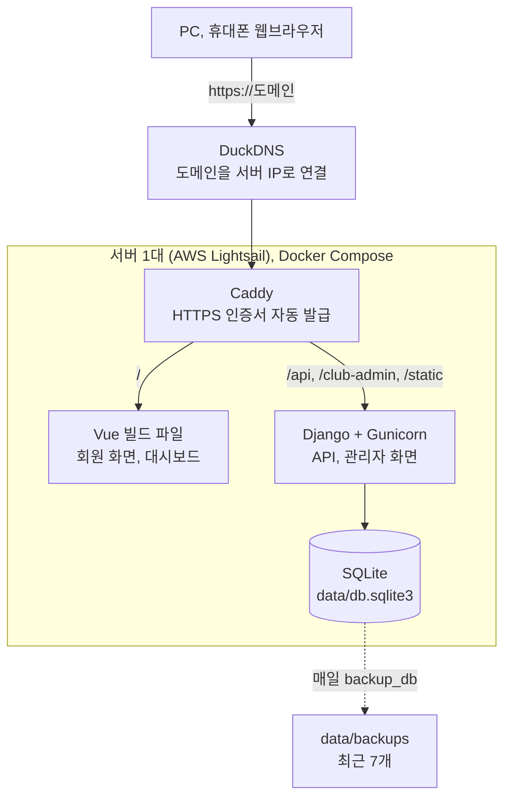
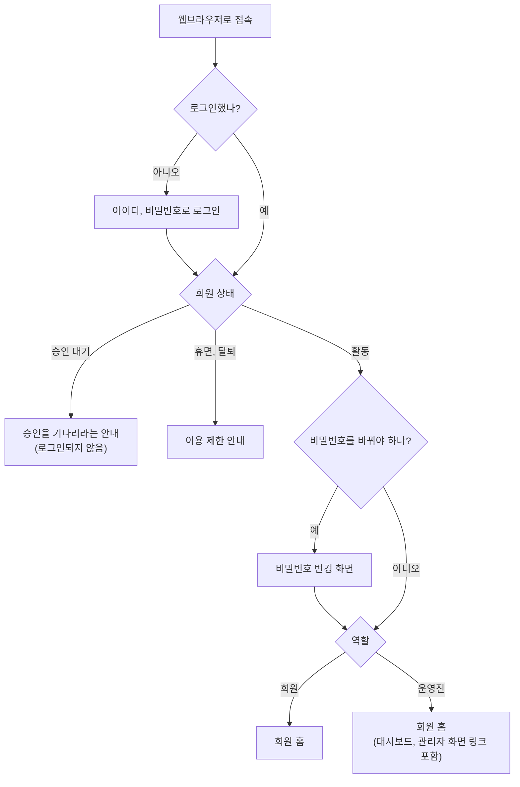
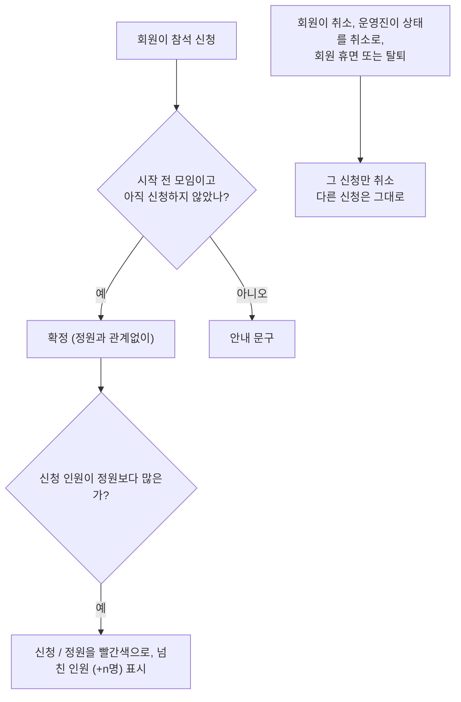
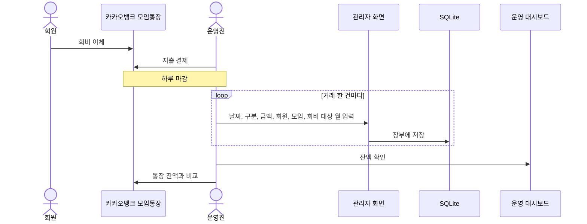
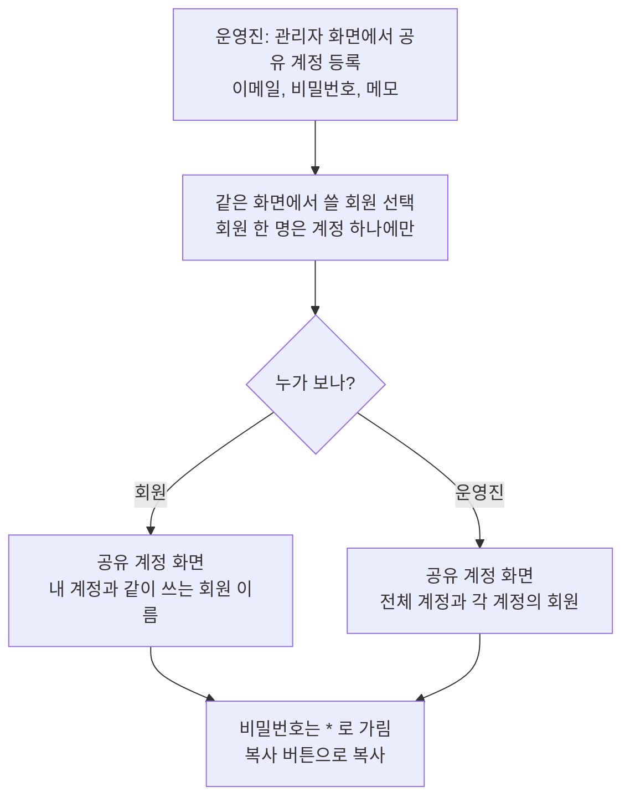
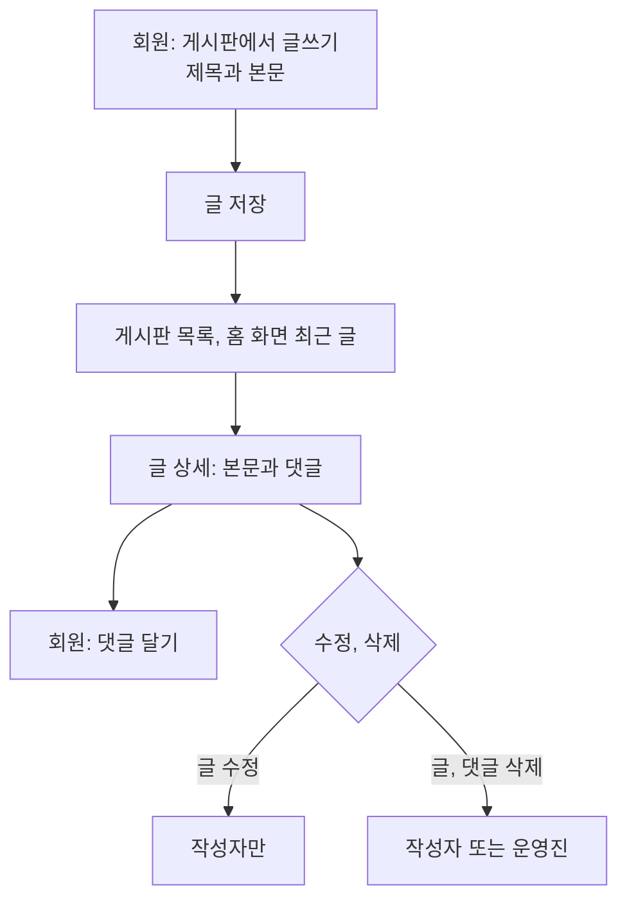

# Club Manager

회원 30명 안팎의 동아리를 위한 웹 앱입니다. 회원은 휴대폰으로 모임에 참석 신청을 하고 출석과 회비 납부 내역을 봅니다. 운영진은 모임통장 거래를 장부에 옮겨 적고, 미납자와 잔액을 대시보드에서 확인합니다.

운영진이라면 [준비물](#준비물)부터 [서버에 설치하기](#서버에-설치하기), [운영하기](#운영하기), [업데이트와 백업](#업데이트와-백업) 순서로 읽으면 됩니다. 코드를 고치려면 [개발하기](#개발하기)로 가세요.

## 주요 기능

| 기능 | 회원 | 운영진 |
| --- | --- | --- |
| 계정 | 회원가입(운영진 승인 뒤 로그인), 첫 로그인 때 비밀번호 변경 | 가입 승인, 계정 발급, 비밀번호 초기화, 활동/휴면/탈퇴 관리 |
| 모임 | 다가오는 모임 목록과 상세, 참석 신청과 취소, 지난 모임 달력(모임이 있던 날과 내가 출석한 날 표시) | 일시, 장소, 정원을 정해 모임 등록 |
| 정원 | 신청 인원과 정원 보기 (넘치면 빨간색으로 넘친 인원 표시) | 정원을 넘어도 신청을 받고, 모임 목록에서 넘친 인원 확인 |
| 출석 | 내 출석 기록과 출석률 | 모임별 출석 체크, 회원별 출석률(전체, 연도별, 월별) |
| 회비 | 내 월별 회비 납부 내역 | 장부 입력, 회비 미납자 목록 |
| 정산 | | 잔액, 구분별 합계, 월별 수입과 지출 |
| 공지 | 홈과 공지 목록에서 보기 | 공지 작성과 수정 |
| 게시판 | 글과 댓글 쓰기, 내 글 수정과 삭제, 홈에서 최근 글 보기 | 남의 글과 댓글도 삭제 |
| 공유 계정 | 내 공유 계정의 이메일과 비밀번호, 같이 쓰는 회원 이름 | 공유 계정 등록, 회원 배정, 전체 목록 보기 |

돈은 카카오뱅크 모임통장으로 주고받습니다. 앱은 납부 여부나 잔액을 따로 저장하지 않고 장부에 적은 거래로 매번 계산합니다. 그래서 회원 화면과 대시보드의 숫자가 서로 어긋나지 않습니다.

| 주소 | 화면 | 누가 |
| --- | --- | --- |
| `/` | 회원 화면 | 모두 |
| `/staff` | 회원 화면의 운영 탭 (잔액·미납 요약, 관리자 화면 바로 가기) | 운영진 |
| `/dashboard` | 운영 대시보드 | 운영진 |
| `/club-admin/` | 관리자 화면 (회원, 모임, 장부 입력, 공유 계정, 게시판 글) | 운영진 |

운영진은 회원 화면의 운영 탭에서 대시보드와 관리자 화면으로 들어갑니다. 관리자 화면 왼쪽 위 '‹ 운영 화면' 버튼을 누르면 운영 탭으로 돌아옵니다.

## 준비물

- AWS 계정(결제 카드 등록 필요)과 그 안의 Lightsail 서버 한 대: Ubuntu, 메모리 1GB 요금제. 공인 IPv4가 붙은 요금제를 고르세요. IPv6 전용 요금제는 DuckDNS로 접속할 수 없습니다. 금액은 Lightsail 요금표에서 확인하세요.
- 무료 도메인: [DuckDNS](https://www.duckdns.org)에서 만든 `이름.duckdns.org`
- 카카오뱅크 모임통장
- 서버에 접속할 PC (Lightsail 콘솔의 브라우저 SSH로도 됩니다)

HTTPS 인증서는 앱에 들어 있는 Caddy가 받아 오도록 되어 있어 따로 살 필요가 없습니다.

이 설치 절차는 아직 실제 서버에서 끝까지 해 보지 않았습니다. Docker 이미지 빌드, HTTPS 인증서 발급, 화면 파일 캐시 설정은 첫 설치 때 제대로 되는지 확인해 주세요.

## 서버에 설치하기

1. Lightsail에서 Ubuntu 인스턴스(1GB)를 만들고 고정 IP를 붙입니다. 네트워킹 탭의 방화벽에 80번과 443번 포트를 엽니다.

2. DuckDNS에 로그인해 도메인을 하나 만들고, 1번의 고정 IP를 입력합니다.

3. 서버에 접속해 스왑(디스크 일부를 메모리처럼 쓰는 공간) 2GB를 추가합니다. 메모리 1GB만으로는 이미지를 빌드하다 메모리가 모자랄 수 있습니다.

   ```bash
   sudo fallocate -l 2G /swapfile && sudo chmod 600 /swapfile
   sudo mkswap /swapfile && sudo swapon /swapfile
   echo '/swapfile none swap sw 0 0' | sudo tee -a /etc/fstab
   ```

4. Docker를 설치합니다. 설치가 끝나면 접속을 끊고 다시 로그인해야 `docker` 명령을 쓸 수 있습니다.

   ```bash
   curl -fsSL https://get.docker.com | sudo sh
   sudo usermod -aG docker $USER
   ```

5. 코드를 받고, 비밀 키를 하나 만들어 둡니다. 출력된 긴 문자열을 복사해 두세요.

   ```bash
   git clone https://github.com/keepmind7/AI_Club_Web club && cd club
   python3 -c "import secrets; print(secrets.token_urlsafe(50))"
   ```

6. 설정 파일을 만들고 네 항목을 채웁니다. nano에서 저장은 `Ctrl+O`와 `Enter`, 종료는 `Ctrl+X`입니다.

   ```bash
   cp .env.example .env
   nano .env
   ```

   | 항목 | 예시 | 설명 |
   | --- | --- | --- |
   | `DOMAIN` | `myclub.duckdns.org` | 2번에서 만든 도메인 |
   | `SECRET_KEY` | (5번에서 만든 문자열) | 비어 있으면 앱이 시작하지 않습니다 |
   | `ALLOWED_HOSTS` | `myclub.duckdns.org` | 보통 도메인과 같습니다 |
   | `CSRF_TRUSTED_ORIGINS` | `https://myclub.duckdns.org` | 도메인 앞에 `https://`를 붙입니다 |

7. 앱을 실행하고 첫 운영진 계정을 만듭니다. 첫 실행은 이미지를 빌드하느라 시간이 좀 걸립니다. 계정을 만들 때 아이디(Username), 이메일(비워도 됨), 비밀번호를 영어 안내에 따라 차례로 입력합니다. 비밀번호는 아래 [비밀번호 규칙](#비밀번호-규칙)을 따라야 합니다.

   ```bash
   docker compose up -d --build
   docker compose exec django python manage.py createsuperuser
   ```

8. 브라우저에서 `https://도메인`을 열고 방금 만든 계정으로 로그인합니다.

동아리의 모든 데이터는 `data/` 폴더와 `.env` 파일에 있습니다. 백업하거나 서버를 옮길 때는 이 둘만 챙기면 됩니다.

## 운영하기

### 처음 설정

관리자 화면(`/club-admin/`)에는 로그인 계정을 다루는 '회원 계정' 메뉴와 이름, 상태 같은 회원 정보를 다루는 '회원' 메뉴가 따로 있습니다. 회원 한 명은 회원 계정 하나와 회원 정보 하나로 이루어집니다.

1. 운영 설정에서 월 회비를 넣습니다. 이미 모아 둔 돈이 있으면 이월 잔액과 이월 기준일도 넣습니다. 이월 잔액은 이월 기준일의 거래까지 모두 반영한 통장 잔액이고, 장부에는 그다음 날 거래부터 입력합니다.
2. 회원을 받습니다. 회원이 앱의 회원가입 화면에서 직접 가입하고 운영진이 승인하는 방법이 기본입니다([가입 승인](#가입-승인)). 운영진이 대신 만들어 줄 때는 회원 계정 메뉴에서 회원 계정을 추가하고, 같은 화면 아래쪽 회원 칸에 이름, 연락처, 가입일을 채웁니다.
3. 운영진을 더 두려면 그 사람의 회원 계정 편집 화면에서 '운영진'을 체크합니다. 체크한 사람은 관리자 화면과 운영 대시보드를 모두 쓸 수 있습니다. createsuperuser로 만든 첫 운영진 계정에는 회원 정보가 없어서 모임에 참석 신청을 할 수 없습니다. 운영진도 모임에 나간다면 회원 계정 편집 화면 아래쪽 회원 칸에 이름, 연락처, 가입일을 넣으세요.
4. 모임을 등록합니다.

기존 회원을 옮겨 올 때는 가입일을 정확히 넣으세요. 미납 회비를 가입한 달부터 세기 때문에, 가입일이 오래전이면 그동안의 회비가 모두 미납으로 나옵니다. 가입일을 앱을 쓰기 시작한 달로 맞추거나 지난 회비를 장부에 넣으면 됩니다.

### 가입 승인

회원은 가입 화면에서 아이디(중복 확인 버튼으로 미리 확인), 비밀번호, 이름, 연락처, 이메일을 넣습니다. 연락처와 이메일은 꼭 넣어야 하고, 이메일은 관리자 화면의 회원 계정에서 보고 고칠 수 있습니다. 가입하면 '승인 대기' 상태로 들어오고, 승인 전에는 로그인할 수 없습니다. 관리자 화면 첫 화면의 바로 가기에 '가입 승인 대기 N명'이 보이면 눌러서 승인 대기 회원 목록으로 갑니다. 아는 사람인지 확인하고 그 줄의 상태를 '활동'으로 바꾼 뒤 아래 '저장'을 누릅니다. 여러 명이면 체크한 뒤 목록 위 '가입 승인' 버튼을 눌러도 됩니다. 승인한 날이 가입일이 되어 회비는 그달부터 셉니다.

모르는 사람의 가입은 회원 계정 메뉴에서 그 계정을 삭제해 거절합니다. 회원 메뉴에서 회원 정보만 지워도 로그인은 막히지만 아이디가 남으니, 아이디까지 지우려면 회원 계정 메뉴에서 삭제하세요.

### 회원에게 알려 줄 것

회원에게 사이트 주소를 보내고, 회원가입한 뒤 운영진 승인을 기다리라고 안내합니다. 운영진이 계정을 대신 만들었다면 아이디와 임시 비밀번호를 보내 주세요. 그 회원은 첫 로그인 때 비밀번호를 새로 정합니다. 휴대폰 브라우저 메뉴의 '홈 화면에 추가'를 쓰면 앱처럼 바로 열 수 있습니다.

회원은 홈에서 공지, 다가오는 모임, 내가 신청한 모임, 게시판 최근 글을 봅니다. 모임 탭 아래쪽 달력에서는 모임이 있던 날에 빈 동그라미, 내가 출석한 날에 채운 동그라미가 보이고, 날짜를 누르면 그날 모임이 나옵니다. 모임 상세에서 참석을 신청하거나 취소하고, 출석과 납부 메뉴에서 자기 기록(아직 내지 않은 회비 포함)을 봅니다. 게시판에는 글과 댓글을 쓸 수 있습니다.

### 매일 하는 일

하루를 마감할 때 그날 모임통장에 찍힌 거래를 관리자 화면의 장부 거래에 한 건씩 입력합니다. 그다음 대시보드의 잔액이 통장 잔액과 같은지 봅니다. 장부 거래는 세 가지로 나눕니다. 모임 비용도 따로 걷지 않고 회비에서 씁니다.

| 구분 | 방향 | 함께 입력할 것 |
| --- | --- | --- |
| 회비 | 입금 | 회원, 회비 대상 월 (여러 달을 미리 냈으면 달마다 한 줄씩) |
| 기타 수입 | 입금 | 메모 |
| 지출 | 출금 | 모임(선택), 메모 |

모임이 끝나면 관리자 화면의 그 모임 아래 신청자 목록에서 출석과 결석을 체크합니다. 대시보드에서는 회비 미납자와 출석률을 볼 수 있습니다.

### 공유 계정

여럿이 같이 쓰는 외부 서비스 계정(팀 플랜 등)은 관리자 화면의 공유 계정 메뉴에 이메일, 비밀번호, 메모를 넣어 등록합니다. 같은 화면 아래쪽 '쓰는 회원'에서 회원을 골라 오른쪽으로 옮기고 저장하면 배정됩니다. 회원 한 명은 계정 하나에만 속하므로, 다른 계정에 있던 회원을 고르면 그 계정에서 빠지고 이 계정으로 옮겨집니다.

회원은 앱의 공유 계정 화면에서 자기 계정과 같이 쓰는 회원 이름을 봅니다. 비밀번호는 가려져 있고 복사 버튼으로만 꺼낼 수 있습니다. 운영진은 전체 계정을 봅니다.

### 게시판

부적절한 글은 관리자 화면 > 게시판 글에서 삭제합니다. 글을 지우면 댓글도 함께 지워지고, 댓글만 지우려면 그 글 화면 아래 댓글 목록에서 삭제를 체크하고 저장합니다. 앱의 글 화면에서도 운영진에게는 삭제 버튼이 보입니다. 운영진도 남의 글을 고칠 수는 없습니다.

### 비밀번호 규칙

비밀번호는 8자 이상으로, 영문·숫자·특수문자를 모두 넣어야 하고 특수문자로 시작할 수 없습니다. 아이디와 비슷하거나 흔한 비밀번호도 쓸 수 없습니다. 회원가입, 비밀번호 변경, 관리자 화면의 계정 추가와 비밀번호 초기화, 첫 운영진 계정 만들기(createsuperuser)에 모두 같은 규칙이 걸립니다. createsuperuser에서 규칙에 안 맞는 비밀번호를 넣으면 `Bypass password validation and create user anyway? [y/N]`라고 묻는데, 여기서는 `N`을 누르고 규칙에 맞는 비밀번호를 다시 넣으세요. 이미 정해 둔 비밀번호는 그대로 쓸 수 있고, 새로 정할 때만 이 규칙을 따릅니다. 비밀번호는 Django 내장 scrypt로 저장합니다(기본 PBKDF2보다 로그인이 빠릅니다). 예전 방식으로 저장된 비밀번호는 그 회원이 다음에 로그인할 때 자동으로 바뀝니다.

### 비밀번호를 잊은 회원

관리자 화면의 회원 계정 메뉴에서 그 회원의 비밀번호를 임시 비밀번호(위 규칙을 따름)로 바꿔 줍니다. 회원은 다음 로그인 때 비밀번호를 새로 정하게 됩니다. 비밀번호를 5번 연달아 틀리면 10분 동안 로그인할 수 없으니, 그동안은 기다리라고 안내하세요.

### 주의할 점

> [!WARNING]
> 그만둔 회원은 삭제하지 말고 회원 상태를 '탈퇴'로 바꾸세요. 장부 거래가 있는 회원과 게시판에 글이나 댓글을 쓴 계정은 삭제가 막혀 있고, 거래가 없는 회원을 삭제하면 신청 기록과 출석 기록이 함께 지워집니다.

- 월 회비를 올리면 이미 낸 지난달까지 미납으로 바뀔 수 있습니다. 회비는 지금 금액을 기준으로 따지기 때문입니다. 올리기 전에 차액을 어떻게 받을지 정해 두세요.
- 신청한 사람을 모임에서 빼려면 그 모임 화면의 신청 목록에서 상태를 '취소'로 바꾸세요. 다른 사람의 신청은 바뀌지 않습니다.
- 예전 버전에서 쓰던 참가비·환불 거래는 업데이트할 때 각각 기타 수입·지출로 바뀌고 메모 앞에 `[참가비]`, `[환불]`이 붙습니다. 잔액은 그대로입니다. 대기 중이던 신청은 시작 전 모임이면 확정, 이미 지난 모임이면 취소가 됩니다(출석률에 들어가지 않게).
- 공유 계정 비밀번호는 회원에게 다시 보여 줘야 해서 DB에 그대로 저장됩니다. 백업 파일과 PC로 내려받은 파일은 남이 보지 못하는 곳에 보관하세요.
- 운영진에서 물러나는 사람이 있으면 사용자 편집 화면에서 '운영진' 체크를 꺼야 합니다. 관리자 화면은 회원 상태가 아니라 이 체크로 출입을 정합니다.

### 관리자 화면 목록에서

회원, 모임, 장부 같은 목록에서 줄을 체크하면 검색창 오른쪽(휴대폰에서는 표 위)의 버튼이 켜집니다. [수정]은 한 줄만 체크했을 때 그 줄의 편집 화면으로 가고, [삭제]는 팝업에서 한 번 더 확인한 뒤 지웁니다. '가입 승인'처럼 목록마다 있는 작업도 같은 자리에 버튼으로 있습니다.

### 문제가 생기면

- 사이트가 열리지 않으면 Lightsail 방화벽에 80번과 443번이 열려 있는지, DuckDNS에 지금 서버 IP가 들어 있는지 확인합니다.
- `docker compose ps`에서 django가 계속 재시작되면 `.env`의 `SECRET_KEY`가 비어 있지 않은지 봅니다. `docker compose logs django`로 오류를 볼 수 있습니다.
- 대시보드 잔액이 통장과 다르면 빠뜨린 거래가 있거나, 이월 잔액과 이월 기준일이 맞지 않는 경우가 대부분입니다. 월별 정산 표에서 어느 달부터 어긋나는지 찾아보세요.

## 업데이트와 백업

### 업데이트

```bash
cd club
git pull
docker compose up -d --build
```

DB 구조가 바뀐 경우에도 앱이 시작하면서 알아서 맞춥니다.

### 매일 백업

서버에서 `crontab -e`를 열고 아래 줄을 넣으면 매일 새벽 4시에 `data/backups/`에 백업 파일이 생깁니다. 최근 7개만 남습니다.

```
0 4 * * * cd /home/ubuntu/club && docker compose exec -T django python manage.py backup_db
```

이 백업은 같은 서버 디스크에 있어서 서버가 망가지면 같이 사라집니다. 서버 밖에도 두 가지로 보관하세요.

1. Lightsail 콘솔의 인스턴스 화면에서 스냅샷 탭을 열고 자동 스냅샷을 켭니다. 디스크 전체를 매일 찍어 7개를 보관하며, 용량에 따라 GB당 월 0.05달러 정도가 붙습니다.
2. 일주일에 한 번쯤 운영진 PC로 내려받습니다. 처음 한 번은 Lightsail 콘솔의 계정 메뉴에서 SSH 키(기본 키)를 PC에 내려받아 둡니다. 그다음 PC의 터미널(Windows PowerShell에도 `scp`가 있습니다)에서 실행합니다.

   ```bash
   mkdir -p club-backups
   scp -i LightsailDefaultKey.pem "ubuntu@서버IP:/home/ubuntu/club/data/backups/db-*.sqlite3" club-backups/
   ```

### 백업에서 되살리기

서버의 `club` 폴더에서 실행합니다. PC에 받아 둔 파일로 되살리려면 먼저 `scp`로 서버의 `data/backups/`에 올립니다.

```bash
docker compose down
cp data/db.sqlite3 data/db-before-restore.sqlite3     # 지금 DB를 따로 남겨 두기
cp data/backups/db-20261108.sqlite3 data/db.sqlite3   # 되살릴 날짜의 파일
docker compose up -d
```

> [!WARNING]
> 되살리면 그 백업 이후에 입력한 장부와 신청은 사라집니다. 위 두 번째 줄처럼 지금 DB를 먼저 복사해 두세요.

### 서버 옮기기

1. 새 서버에서 [서버에 설치하기](#서버에-설치하기)의 1, 3, 4번을 하고, 5번의 `git clone`까지만 실행합니다.
2. 기존 서버에서 `docker compose down`으로 앱을 멈춥니다.
3. 기존 서버의 `data/` 폴더와 `.env`를 새 서버의 `club` 폴더 안으로 복사합니다.
4. 새 서버에서 `docker compose up -d --build`를 실행합니다.
5. DuckDNS의 IP를 새 서버 IP로 바꿉니다.

## 개발하기

### 로컬에서 실행

Windows 기준입니다. Python 3.12와 Node.js 24가 필요합니다.

```powershell
git clone https://github.com/keepmind7/AI_Club_Web.git
cd AI_Club_Web
.\dev.cmd            # Git Bash에서는 ./dev.cmd
```

`dev.cmd`는 가상환경이 없으면 만들고, 실행할 때마다 패키지를 설치(바뀐 것만)하고 DB를 맞춘 뒤 Django(8001번)와 Vite(5173번)를 한 창에서 띄웁니다. 브라우저에서 http://localhost:5173 을 열면 됩니다. `Ctrl+C`를 누르면 둘 다 꺼집니다. 8001번을 다른 프로그램이 쓰고 있으면 `DJANGO_PORT`에 다른 번호를 넣고 실행하세요.

운영진 계정은 처음에 한 번만 만듭니다.

```powershell
backend\.venv\Scripts\python backend\manage.py createsuperuser
```

로컬에서는 `DEBUG=1`이 기본값이어서 `.env` 파일이 없어도 됩니다. DB 파일은 `backend/data/db.sqlite3`에 생깁니다.

macOS나 Linux에서는 둘을 따로 띄웁니다. 이때 Django는 Vite가 기본으로 찾는 8000번을 씁니다.

```bash
cd backend
python -m venv .venv && .venv/bin/pip install -r requirements.txt
.venv/bin/python manage.py migrate
.venv/bin/python manage.py runserver 8000

# 다른 터미널에서
cd frontend && npm install && npm run dev
```

Vite는 `/api`, `/club-admin`, `/static` 요청을 Django로 넘깁니다. Django 주소가 기본값(`http://127.0.0.1:8000`)과 다르면 `DJANGO_URL`로 알려 줍니다.

### 테스트

```bash
cd backend && .venv/Scripts/python manage.py test club   # 백엔드 테스트 67개 (macOS, Linux는 .venv/bin/python)
cd frontend && npm run build                             # 타입 검사와 빌드
```

### 휴대폰으로 확인

[cloudflared](https://developers.cloudflare.com/cloudflare-one/connections/connect-networks/downloads/)로 임시 주소를 열 수 있습니다. 계정은 필요 없고, 명령을 끄면 주소도 사라집니다.

```bash
cloudflared tunnel --url http://localhost:5173
```

출력된 `https://xxx.trycloudflare.com` 주소로 휴대폰에서 접속합니다. Django가 그 주소에서 온 요청을 받아야 하므로, 앱을 띄울 때 주소를 알려 줍니다. `dev.cmd`가 이미 실행 중이면 끄고 다시 실행하세요.

```powershell
$env:ALLOWED_HOSTS = "localhost,127.0.0.1,.trycloudflare.com"
$env:CSRF_TRUSTED_ORIGINS = "http://localhost:5173,https://xxx.trycloudflare.com"
.\dev.cmd
```

### 프로젝트 구조

```
backend/
  config/            Django 설정, URL
  club/
    models.py        회원, 공유 계정, 모임, 참석 신청, 장부 거래, 공지, 게시판 글과 댓글, 운영 설정
    api.py           회원 화면과 대시보드 API
    ledger.py        회비 납부 현황, 미납, 잔액, 출석률 계산
    admin.py         관리자 화면
    permissions.py   활동 회원인지 검사
    tests.py         백엔드 테스트
    management/commands/backup_db.py
  templates/admin/   관리자 화면 모양, 목록의 [수정]·[삭제] 버튼과 삭제 확인 팝업
  Dockerfile  requirements.txt
frontend/
  src/
    api.ts  auth.ts  router.ts  types.ts  format.ts
    pages/           로그인, 홈, 모임(달력 포함), 출석, 납부, 소식(공지·게시판), 공유 계정, 내 정보, 운영, 대시보드 등 15개 화면
    components/      위쪽 '‹ 돌아가기' 줄 같은 공용 부품
  Caddyfile  Dockerfile
docker-compose.yml   .env.example   dev.cmd
동아리 통합 관리 시스템 개발 계획서.md
동작 흐름.md
```

| 구분 | 사용 기술 |
| --- | --- |
| 프론트엔드 | Vue 3, TypeScript, Vite, Tailwind CSS v4, Vue Router, Pinia |
| 백엔드 | Django 5.2, Django REST Framework, whitenoise, gunicorn |
| DB | SQLite |
| 배포 | Docker Compose, Caddy |

## 동작 방식

흐름도 13개는 [동작 흐름.md](동작%20흐름.md)에 있고, 아래는 그중 여섯 가지입니다.

### 시스템 구성



### 접속하면 어느 화면으로 가는지



### 참석 신청과 취소

정원은 신청을 막지 않는 기준 인원입니다. 정원을 넘어 신청해도 모두 확정되고, 회원 앱과 관리자 모임 목록에 `23 / 20명 (+3명)`처럼 넘친 인원이 빨간색으로 보입니다. 정원이 0이면 `23명 · 정원 없음`으로 보입니다. 신청은 DB 트랜잭션 하나로 처리하므로 같은 회원이 버튼을 두 번 눌러도 신청은 하나만 생깁니다.



회원을 휴면이나 탈퇴로 바꾸면 그 회원이 신청해 둔 앞으로의 모임은 모두 취소되고, 지난 모임 기록은 남습니다. 취소한 회원이 다시 신청하면 신청 순서 맨 뒤로 갑니다.

### 하루 마감 장부 입력



### 공유 계정



### 게시판



### 계산 규칙

- 잔액은 이월 잔액에, 이월 기준일 다음 날부터의 입금(회비, 기타 수입)을 더하고 출금(지출)을 뺀 값입니다.
- 회비는 그 달로 입력한 금액의 합이 월 회비 이상이어야 낸 것으로 봅니다. 대시보드 미납자 목록은 지난달까지만 보여 주고, 회원 본인 화면에는 이번 달도 나옵니다.
