# Club Manager 동작 흐름

## 1. 접속과 화면 분기

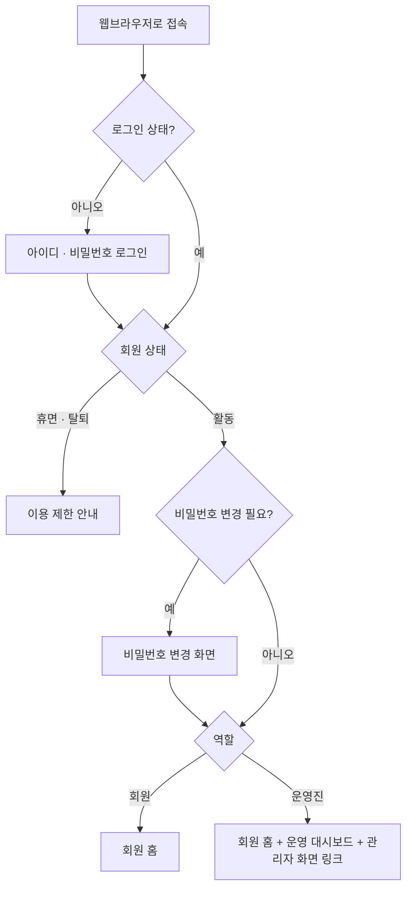

## 2. 계정 발급과 첫 로그인

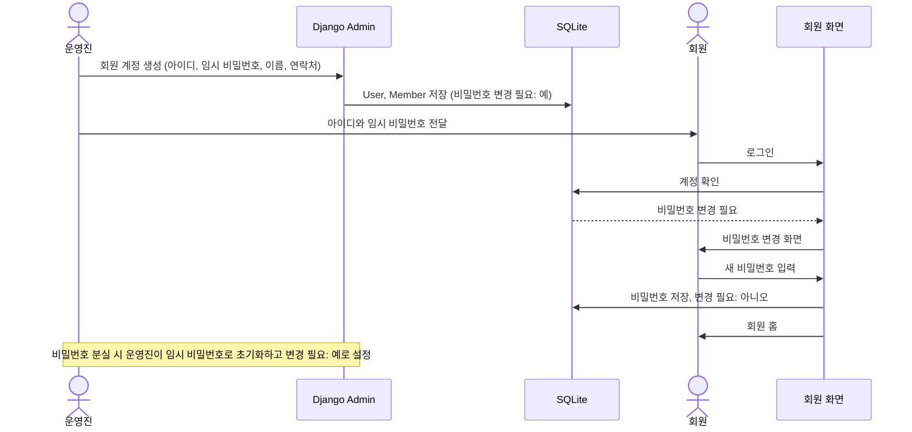

## 3. 모임 등록과 참석 신청

신청은 DB 트랜잭션 하나로 처리되므로 동시에 신청해도 정원을 넘지 않는다.

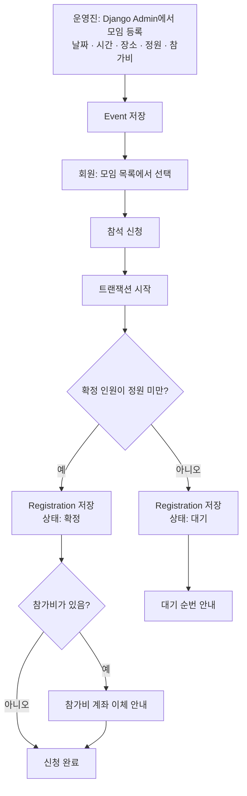

## 4. 참석 취소와 대기자 승격

취소와 대기자 승격은 하나의 트랜잭션으로 처리된다. 시작 전 모임에서 확정 자리가 비면(회원 취소, 관리자 화면에서 신청 취소·정원 증가, 회원을 휴면·탈퇴로 변경) 가장 먼저 신청한 대기자부터 정원까지 자동으로 확정한다. 회원이 휴면·탈퇴로 바뀌면 그 회원의 시작 전 모임 신청은 모두 취소된다.

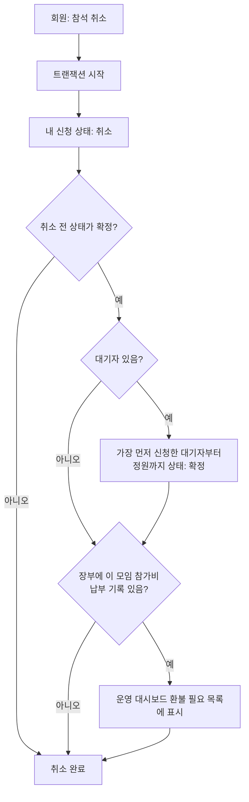

## 5. 출석 관리

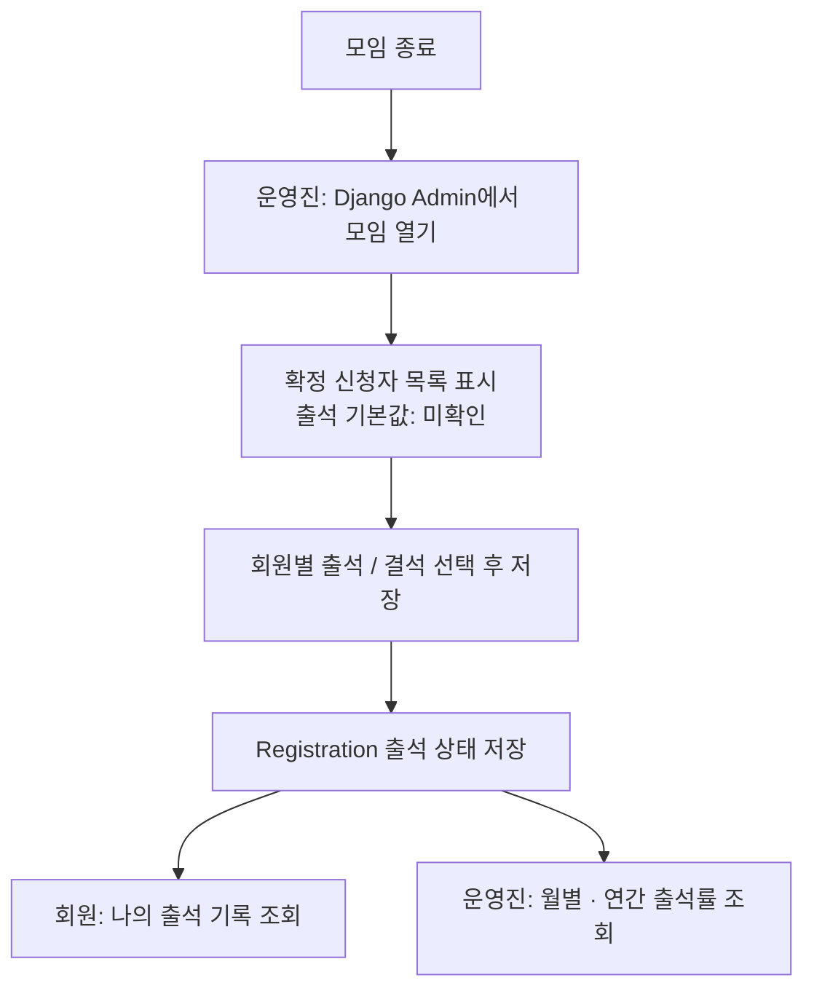

## 6. 하루 마감 장부 입력

회비와 참가비는 회원이 카카오뱅크 모임통장으로 이체하고, 운영진이 하루가 끝나면 거래내역을 앱에 옮겨 적는다.

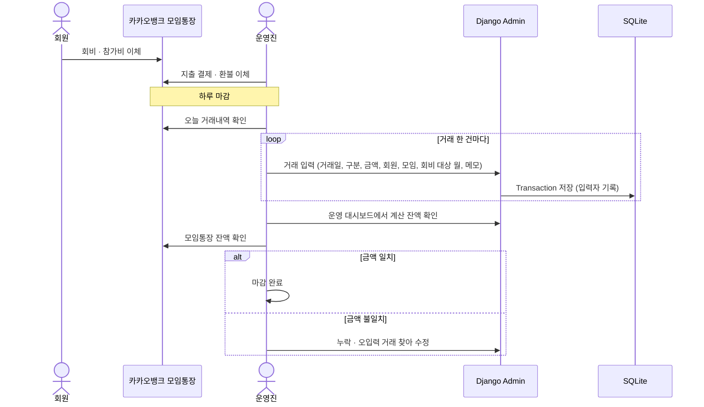

## 7. 거래 구분별 연결 정보

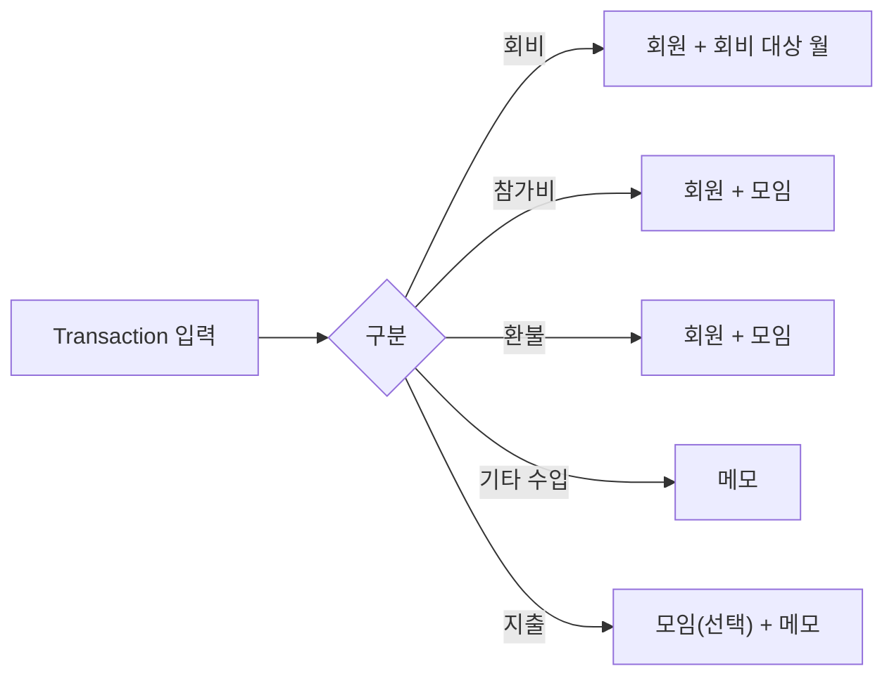

## 8. 회비 · 참가비 납부 현황 계산

납부 여부는 저장하지 않고, 화면을 열 때마다 장부에서 계산한다.

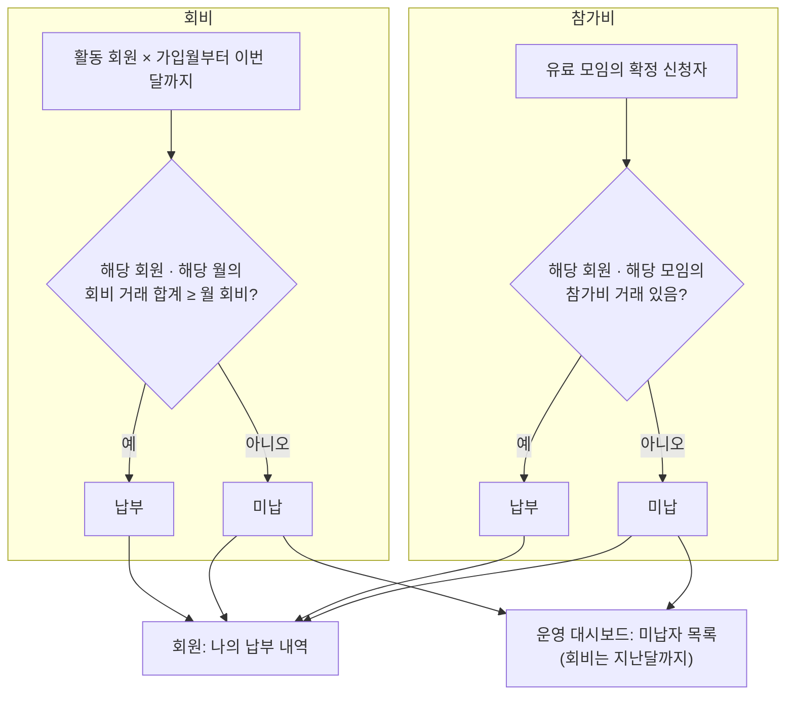

## 9. 잔액과 정산

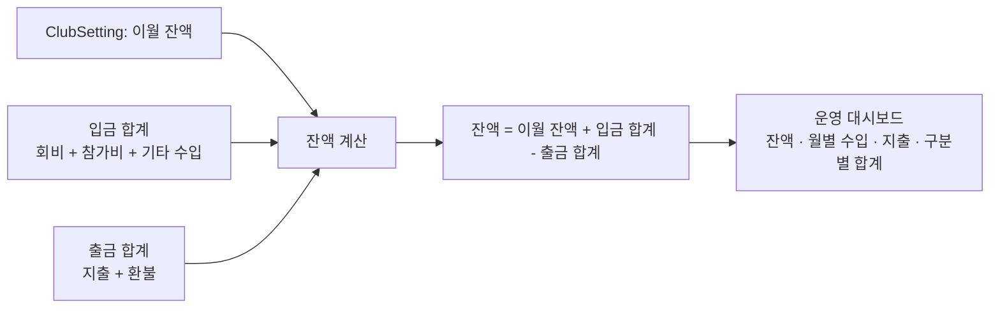

## 10. 공지

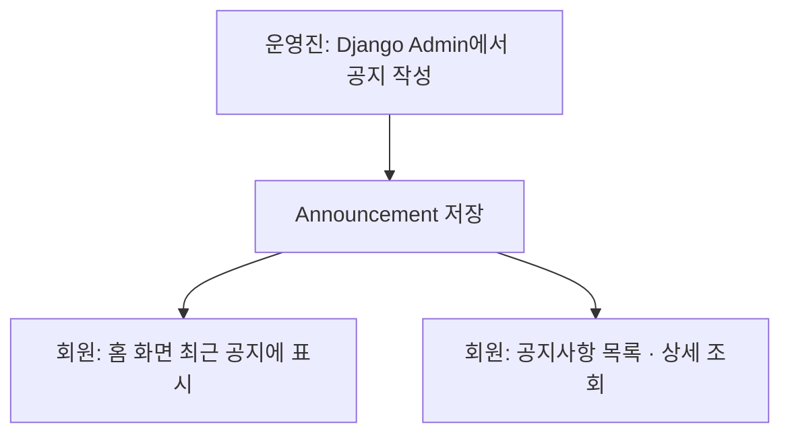

## 11. 권한 검사

모든 요청은 Django에서 아래 순서로 검사된다.

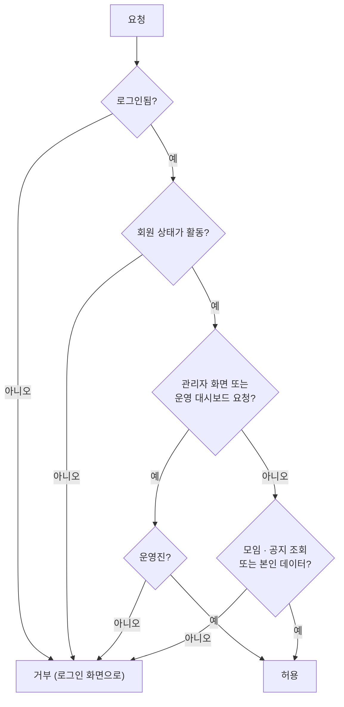
